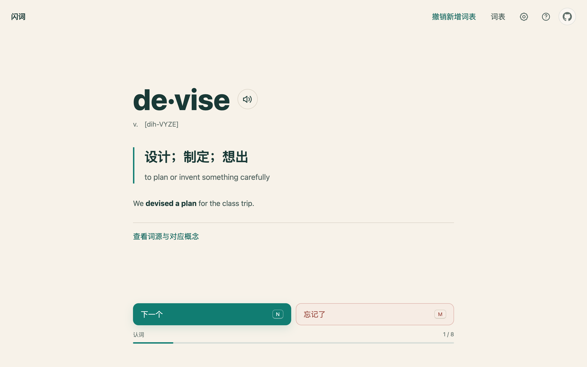
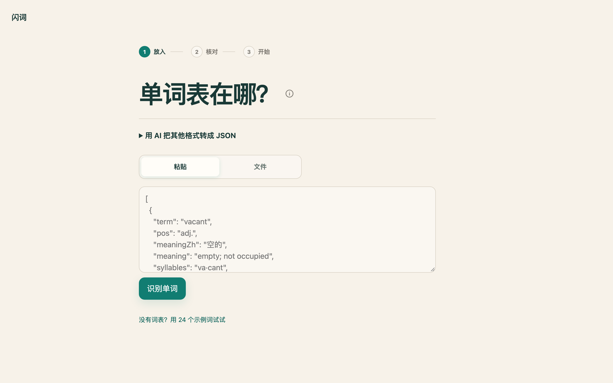

# 闪词 · FlashVocab

**把单词表丢进来，三分钟开始背。**

[](https://github.com/Ganzhe2028/FlashVocab/actions/workflows/ci.yml)

闪词是一个在浏览器里背单词的网页，为「老师今天发了单词表，明天就考」这种场景做的。

不用注册，不用装 App，不用准备 API key。打开网页，把词表放进去，就能开始背；词表和进度只存在你这台设备的浏览器里，不上传。

**▶ 在线使用：[bdc.isaacbao.cn](https://bdc.isaacbao.cn)**



## 它解决的是哪种麻烦

临时的课堂小测通常长这样：老师发一份 Word 或 Excel，二三十个词，明天上课默写，考完这一组基本就不再碰。用大 App 背太重，用纸背又记不住哪些词错过。

闪词只做这一件事——你把这份表放进去，它给你排好一次能背完的练习，考完把这一组收起来，期末再一起复习。

三个特点：

- **固定格式导入。** 上传或粘贴 JSON 词表，字段有问题会指出位置，不再猜格式；没贴对时可以复制一段重改请求，让 AI 修正后再贴回来。
- **键盘优先。** 背的时候手不离键盘，一个词两三个键。
- **只在这台设备。** 没有账号，没有服务器存档，词表不会被传上去。

## 三步开始



**1 放入。** 页面默认展开「用 AI 整理词表」：先复制提示词，和你的 Word 词表一起发给 DeepSeek 或 ChatGPT，再把 AI 生成的内容贴到下面。默认是粘贴；点「文件」会立即打开系统文件选择器，也可以把 `.json` 文件拖进去。词表只留在本机，标题旁的 info 图标说明了这一点。

**2 核对。** 看一眼识别结果：多少个词、多少个有中文释义、前五个词长什么样。缺中文或英文释义会直接标明。确认没问题，点「开始练这 N 个词」。

词缺资料时这一页只多一行「N 个词还没补全资料 · 让 AI 帮忙补全」。这是可选项：复制闪词给的一段文字，粘给任意 AI，再把完整 JSON 数组粘回来，中文释义、词性、词源、对应词、例句、情景一次补齐。已有内容不会被覆盖。不补也能直接开始练。

**3 开始。** 进入认词，不用再点一次确认。新词表第一张卡会提醒你先在心里想一想，第一次选择后提示和导入通知就会收起。

粘贴内容没有通过检查时，页面会用人话说明哪里没对上，并提供「复制给 AI 重改」。复制的话会带上原回复和具体问题；AI 补全和文件转换的备用面板也能这样重改。Word、Excel、Markdown、PDF 等材料都先转成 JSON；转换提示词会要求保留词义、词源、例句和辨析，例句与重点必须包含词条原形，辨析答案只能属于目标词和对应词这一对。应用不会自动把文件或文字发给 AI，发送和复制结果都由你操作。

## 背的时候手不用离开键盘

| 键 | 作用 |
| --- | --- |
| `Q` | 认识 |
| `E` | 不认识 |
| `N` | 看答案之后：下一个 |
| `M` | 选错了，改判成不认识 |
| `←` | 回看上一个词 |
| `Delete` / `Backspace` | 把这个词移出当前词表 |
| `Esc` | 暂停拼写 |

认词只问一件事：这个词你认不认识。按 `Q` 或 `E` 都会展开答案——中文释义用大字在上，英英释义用小字在下，再下面是例句，词源和对应概念折叠着，想看再点。先判断再看答案，比一上来就读释义有效。

## 错过的词会自己回来

- 第一遍标「不认识」的词，这一轮里会**多考两次**，通常隔三张卡再出现。
- 同一个词**连续两轮都答对**，会**歇一整轮**（下一轮先不出现），再下一轮回来；回来还答对就继续歇，答错就回到正常队列。
- **连续三次**独立答对，这个词毕业，从认词里消失。毕业的词还能在词表里找回来。

排队顺序也是按这个来的：错过的词先出，没见过的词在中间，快稳的词靠后。所以越背越轻松，不会每次都从头刷。

默认选中「刷词+拼写错词」，每轮只拼刚才判为「不认识」的词。换词表会保留手动选择的模式，刷新页面或重置学习后恢复默认。

每轮结束会先看到「认识 X · 不认识 Y」，掌握情况只有一句概况，具体数字想看再展开。接下来可以点「再练一轮」、「换一组词」或做「小练习」。换组会直接打开词表面板，关闭后仍回到这张结算页。

## 考完收起来，期末一起复习

每导入一份表就是一组词，默认叫 W1、W2，可以改名。考完这一组，在「词表」面板点「先收起」，它会从日常认词里退场，但词和掌握度都留着。

期末点「全部一起复习」，所有组（包括已经毕业的词）一起回来，手动移出过的词仍然尊重你的选择。

加词表、改名、收起、移出、找回、重置，共用同一个撤销（Undo）——手滑了按一下就能回去。在学习中途加一组词，撤销也会回到刚才那个词，不会把你丢在导入页。

## 小练习：四种接近考试的题

在结算页，或者「词表 → 专项练习」里可以进。练完自动回到刚才的学习现场。

- **看释义选词**：给一个释义（有短情景就优先用情景），从四个词里选最贴切的。
- **看情景选词**：给一个挖掉目标词的句子，看你能否把词填回去。
- **填搭配**：把例句里那个固定搭配挖掉，从词库里选。
- **辨析近义词**：给一个分界线清楚的情景，在目标词和它的对应词之间二选一。

选项每次现场生成并重新洗牌，不会记住上次答案的位置。看释义选词、看情景选词可按 `1`–`4` 选词，或点「我不知道」/ 按 `5`：记一次答错，显示正确答案，按 `N` 继续。其他题型仍用 `1`–`9` 选前九项；所有选项也能按 Tab 或点。


## 你的数据在哪

词表、移出记录、掌握度、外观偏好都存在浏览器本地（`localStorage`），不上传任何服务器。

- **刷新页面**：会重新开始这一轮学习队列，词表和掌握度保留。
- **换浏览器 / 清缓存**：本地数据会没，所以定期导出更保险。
- **导出**：词表面板里的「备份与导出」支持 JSON 和 Markdown；JSON 可以再导入，Markdown 用于阅读。
- **重置进度**：只清掌握度，不动词表，而且能撤销。

## 常见问题

**要注册或登录吗？** 不要，打开就能用。

**要自己准备 API key 吗？** 不需要。导入、认词、拼写、四种专项练习都不联网也不需要 key。词表里有「用 DeepSeek 补全资料（进阶）」，那是给想额外生成记忆短句、干扰词的人用的可选项。

**手机能用吗？** 能。窄到 280px 也不会横向溢出，支持暗色和 200% 放大。

**支持 PDF 或截图里的单词表吗？** 不支持直接导入。可以点「复制给 AI 的话」，把提示词和材料一起交给 DeepSeek 或 ChatGPT 整理，再粘贴返回的 JSON 并自行核对。

**词表会被上传吗？** 闪词不会自动上传。只有你自己把提示词和词表发给第三方 AI 时，材料才会离开这台设备，那一步完全由你操作。

**一次能背多少词？** 没有上限，但它是为二三十个词的小测设计的。几百词的长表更适合拆成几组，或者用专门的背单词 App。

**数据丢了怎么办？** 先看有没有导出过备份。浏览器清缓存、换设备、用隐私窗口都会丢，重要词表建议导出存一份。

## 想自己跑一份

需要 Node 20.19+ 或 22.12+。

```bash
npm install
npm run dev      # 本地开发
npm run check    # ESLint + 逻辑测试 + UI 测试 + 生产构建
npm run build    # 产物在 dist/
```

`./run.sh` 会在缺依赖时自动安装并启动开发服务器。

- 技术文档：[docs/TECHNICAL.md](docs/TECHNICAL.md)（架构、数据模型、学习算法、导入管线、题目生成、测试与部署）
- 版本变更：[Updates.md](Updates.md)
- 当前行为规格：[导入优先改版记录](docs/flashvocab-import-first-2026-10-27.md)、[重设计规格](docs/flashvocab-redesign-2026-10-19.md)
- 开发约定与验证证据：[AGENTS.md](AGENTS.md)、[docs/validation-2026-10-27-practice-fill/](docs/validation-2026-10-27-practice-fill/)

## 已知边界

- 非 JSON 文件需先转换；JSON 中每项 `term` 必填，`meaning` / `meaningZh` 至少一个有内容。
- 中文或英文释义可以只填一种；核对、认词和拼写页会明确显示「缺中文释义」或「缺英文释义」。
- AI 补全的质量取决于你用的 AI 和那段提示词；很长的词表可分批，但每批必须是完整 JSON 数组，截断的内容不会导入。

## 反馈

用着别扭、词表没认出来、想要什么功能，都欢迎开 [Issue](https://github.com/Ganzhe2028/FlashVocab/issues) 说一句。
