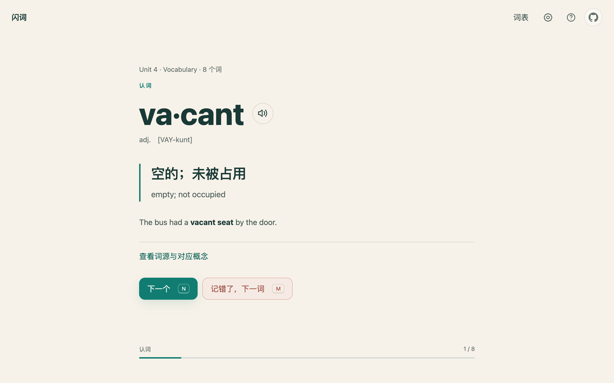
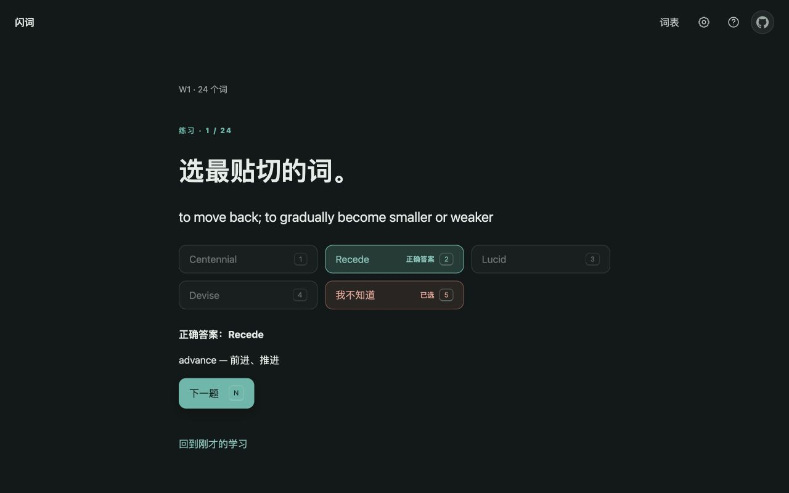

# 闪词 · FlashVocab

**把单词表丢进来，三分钟开始背。**

[](https://github.com/Ganzhe2028/FlashVocab/actions/workflows/ci.yml)

闪词是一个在浏览器里背单词的网页，为「老师今天发了单词表，明天就考」这种场景做的。

不用注册，不用装 App，不用准备 API key。打开网页，把词表放进去，就能开始背；词表和进度只存在你这台设备的浏览器里，不上传。

**▶ 在线使用：[bdc.isaacbao.cn](https://bdc.isaacbao.cn)**



## 它解决的是哪种麻烦

临时的课堂小测通常长这样：老师发一份 Word 或 Excel，二三十个词，明天上课默写，考完这一组基本就不再碰。用大 App 背太重，用纸背又记不住哪些词错过。

闪词只做这一件事——你把这份表放进去，它给你排好一次能背完的练习，考完把这一组收起来，期末再一起复习。

三个特点：

- **固定格式导入。** 上传或粘贴 JSON 词表，字段有问题会指出位置，不再猜格式。
- **键盘优先。** 背的时候手不离键盘，一个词两三个键。
- **只在这台设备。** 没有账号，没有服务器存档，词表不会被传上去。

## 三步开始


**1 放入。** 选「文件」或「粘贴」。只接受 `.json` 文件或纯 JSON 数组；不带代码围栏、说明文字或包装对象。页面可下载模板；其他材料点「把其他格式转成 JSON」，复制提示词交给 AI 转换。

**2 核对。** 看一眼识别结果：多少个词、多少个有中文释义、前五个词长什么样。确认没问题，点「开始背这 N 个词」。

词缺资料时这一页只多一行「N 个词还没补全资料 · 让 AI 补全」。这是可选项：复制闪词给的一段文字，粘给任意 AI，再把完整 JSON 数组粘回来，中文释义、词性、词源、对应词、例句、情景一次补齐。已有内容不会被覆盖，可以直接照模板填写。不补也能直接开始背。

**3 开始。** 进入认词，不用再点一次确认。

Word、Excel、Markdown、PDF 等材料都先转成 JSON；转换提示词会要求保留词义、词源、例句和辨析。应用不会自动把文件发给 AI。

## 背的时候手不用离开键盘

| 键 | 作用 |
| --- | --- |
| `Q` | 认识 |
| `E` | 不认识 |
| `N` | 看答案之后：下一个 |
| `M` | 选错了，改判成不认识 |
| `←` | 回看上一个词 |
| `Delete` / `Backspace` | 把这个词移出当前词表 |
| `Esc` | 暂停拼写 |

认词只问一件事：这个词你认不认识。按 `Q` 或 `E` 都会展开答案——中文释义用大字在上，英英释义用小字在下，再下面是例句，词源和对应概念折叠着，想看再点。先判断再看答案，比一上来就读释义有效。

## 错过的词会自己回来

- 第一遍标「不认识」的词，这一轮里会**多考两次**，通常隔三张卡再出现。
- 同一个词**连续两轮都答对**，会**歇一整轮**（下一轮先不出现），再下一轮回来；回来还答对就继续歇，答错就回到正常队列。
- **连续三次**独立答对，这个词毕业，从认词里消失。毕业的词还能在词表里找回来。

排队顺序也是按这个来的：错过的词先出，没见过的词在中间，快稳的词靠后。所以越背越轻松，不会每次都从头刷。

## 考完收起来，期末一起复习

每导入一份表就是一组词，默认叫 W1、W2，可以改名。考完这一组，在「词表」面板点「先收起」，它会从日常认词里退场，但词和掌握度都留着。

期末点「全部一起复习」，所有组（包括已经毕业的词）一起回来，手动移出过的词仍然尊重你的选择。

加词表、改名、收起、移出、找回、重置，共用同一个撤销（Undo）——手滑了按一下就能回去。在学习中途加一组词，撤销也会回到刚才那个词，不会把你丢在导入页。

## 练一练：四种接近考试的题

在结算页，或者「词表 → 专项练习」里可以进。练完自动回到刚才的学习现场。

- **看释义选词**：给一个释义（有短情景就优先用情景），从四个词里选最贴切的。
- **看情景选词**：给一个挖掉目标词的句子，看你能否把词填回去。
- **填搭配**：把例句里那个固定搭配挖掉，从词库里选。
- **辨析近义词**：给一个分界线清楚的情景，在目标词和它的对应词之间二选一。

选项每次现场生成并重新洗牌，不会记住上次答案的位置。数字键 `1`–`9` 选前九项，其他选项按 Tab 或点。



## 你的数据在哪

词表、移出记录、掌握度、外观偏好都存在浏览器本地（`localStorage`），不上传任何服务器。

- **刷新页面**：会重新开始这一轮学习队列，词表和掌握度保留。
- **换浏览器 / 清缓存**：本地数据会没，所以定期导出更保险。
- **导出**：词表面板里的「备份与导出」支持 JSON 和 Markdown；JSON 可以再导入，Markdown 用于阅读。
- **重置进度**：只清掌握度，不动词表，而且能撤销。

## 常见问题

**要注册或登录吗？** 不要，打开就能用。

**要自己准备 API key 吗？** 不需要。导入、认词、拼写、四种专项练习都不联网也不需要 key。词表里有「用 DeepSeek 补全资料（进阶）」，那是给想额外生成记忆短句、干扰词的人用的可选项。

**手机能用吗？** 能。窄到 280px 也不会横向溢出，支持暗色和 200% 放大。

**支持 PDF 或截图里的单词表吗？** 不支持。PDF 和图片要靠 OCR，猜错了会让人背错词，可以通过「把其他格式转成 JSON」交给 AI 整理并自行核对。

**词表会被上传吗？** 不会。唯一会把东西发出去的地方是你自己复制提示词粘给第三方 AI，那一步完全由你操作。

**一次能背多少词？** 没有上限，但它是为二三十个词的小测设计的。几百词的长表更适合拆成几组，或者用专门的背单词 App。

**数据丢了怎么办？** 先看有没有导出过备份。浏览器清缓存、换设备、用隐私窗口都会丢，重要词表建议导出存一份。

## 想自己跑一份

需要 Node 20.19+ 或 22.12+。

```bash
npm install
npm run dev      # 本地开发
npm run check    # ESLint + 逻辑测试 + UI 测试 + 生产构建
npm run build    # 产物在 dist/
```

`./run.sh` 会在缺依赖时自动安装并启动开发服务器。

- 技术文档：[docs/TECHNICAL.md](docs/TECHNICAL.md)（架构、数据模型、学习算法、导入管线、题目生成、测试与部署）
- 版本变更：[Updates.md](Updates.md)
- 当前行为规格：[导入优先改版记录](docs/flashvocab-import-first-2026-10-27.md)、[重设计规格](docs/flashvocab-redesign-2026-10-19.md)
- 开发约定与验证证据：[AGENTS.md](AGENTS.md)、[docs/validation-2026-10-27-practice-fill/](docs/validation-2026-10-27-practice-fill/)

## 已知边界

- 非 JSON 文件需先转换；JSON 中每项 `term` 必填，`meaning` / `meaningZh` 至少一个有内容。
- 没有中文释义的词也能导入，但答案页的中文会是空的，预览会明确提示。
- AI 补全的质量取决于你用的 AI 和那段提示词；很长的词表可分批，但每批必须是完整 JSON 数组，截断的内容不会导入。

## 反馈

用着别扭、词表没认出来、想要什么功能，都欢迎开 [Issue](https://github.com/Ganzhe2028/FlashVocab/issues) 说一句。
